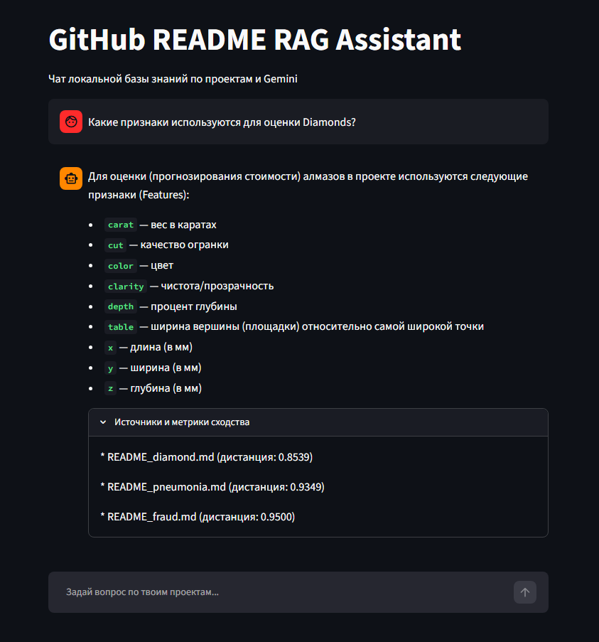

# GitHub README RAG Assistant

An intelligent, context-aware RAG (Retrieval-Augmented Generation) application designed to search, query, and chat with local GitHub repository documentation (`.md` files) using a local vector database (**ChromaDB**) and **Google Gemini API**.

Featuring an interactive web interface powered by **Streamlit**, conversational memory with query contextualization, and transparent distance-based relevance scoring.

---

## Key Features

* **Local Vector Store:** High-performance indexing and vector search using `chromadb` and `sentence-transformers` (`all-MiniLM-L6-v2` model with 384 dimensions).
* **Smart Chunking:** Text splitting with overlap to preserve semantic context across documentation boundaries.
* **Conversational Memory:** Sliding window context memory (`chat_history`) that tracks prior turns without bloating model context.
* **Query Contextualization:** Automatically converts follow-up questions (e.g., *"What features were used?"*) into standalone search queries using Gemini.
* **Distance Scoring:** Displays real-time cosine/L2 distance metrics for retrieved document chunks for full search transparency.
* **Interactive UI:** Clean chat interface built with **Streamlit**, featuring expandable panels for source inspection and metrics.

---

## Screenshot


---

## Tech Stack

* **Language:** Python 3.12+
* **Vector Database:** `chromadb`
* **Embeddings Model:** `sentence-transformers` (`all-MiniLM-L6-v2` via PyTorch)
* **LLM Engine:** Google Gemini API (`google-genai` SDK, `gemini-3.5-flash` model)
* **Frontend:** `streamlit`
* **Environment Management:** `python-dotenv`

---

## Project Structure

```text
rag-readme/
├── data/                  # Source Markdown files (.md) to be indexed
├── chroma_db/             # Persistent local vector database directory (git-ignored)
├── .env                   # Environment variables (GEMINI_API_KEY)
├── ingest.py              # Indexing script: reads MD files, chunks, & embeds into ChromaDB
├── query.py               # CLI version of the RAG assistant with conversational memory
├── app.py                 # Streamlit Web Application
├── requirements.txt       # Project dependencies
└── README.md              # Project documentation